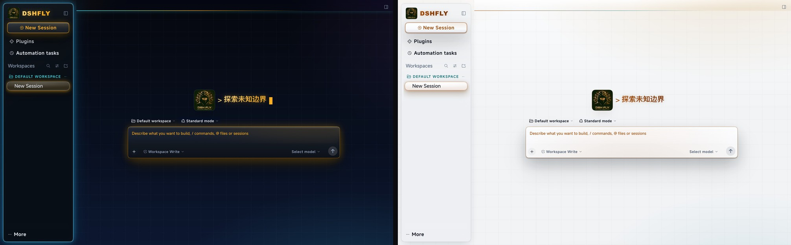
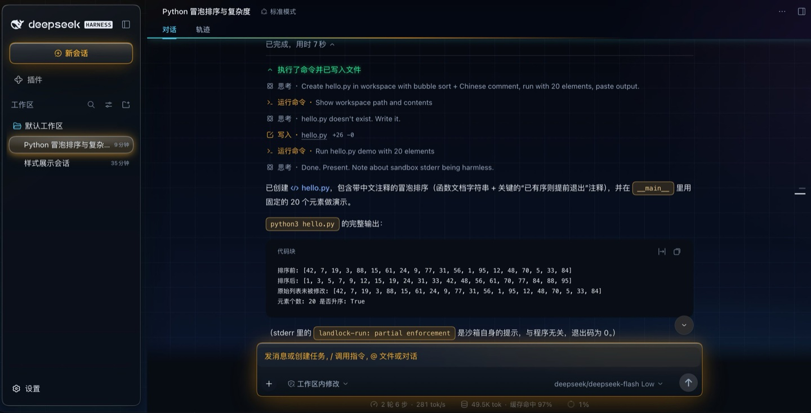
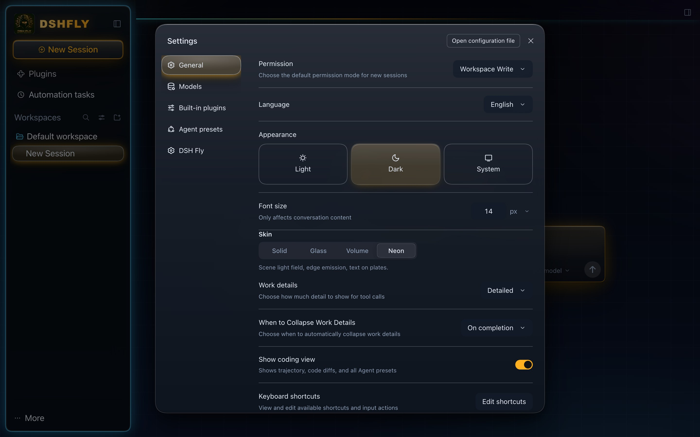
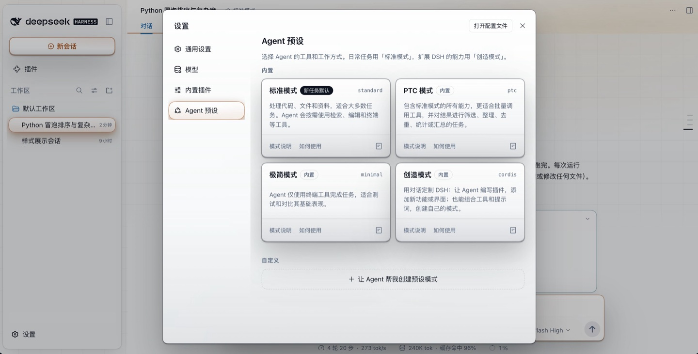
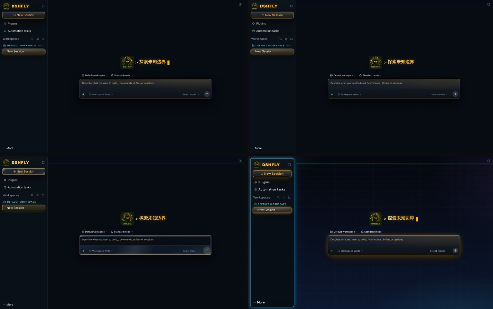
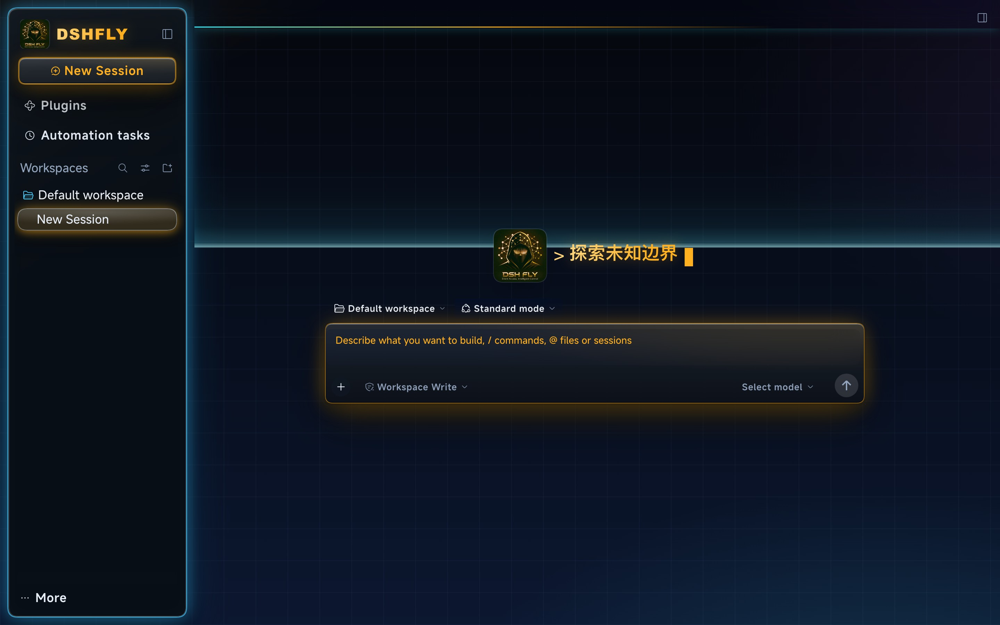

# Fly Skins — palettes for the DeepSeek Harness web UI

**A standard DSH skin plugin: four palettes, light and dark halves, plus a 125% sidebar type scale.**
**标准 DSH 皮肤插件：四套配色（各含明暗两半），外加 125% 的侧栏字号。**

`@dsh-fly/dsh-plugin-fly-skins` · category **theme** · MIT

## Neon — the flagship palette

A scene light field behind the whole window: deep navy canvas, a 46px circuit grid running edge
to edge, cyan edge-glow bleeding out of the rail card, and text sitting on its own plate so it
stays sharp over the field. Dark and light are two halves of the same recipe, not two themes.

**霓虹是主打配色**：整窗一张场景光场（深蓝画布 + 46px 电路网格）、栏卡外溢青光、
文字坐字座；明暗两半是同一套配方的两个半区，不是两套主题。



In a running session (the todo panel is live, so the cyan ring on it is real):



Settings dialog, both halves:

| neon · dark | neon · light |
| --- | --- |
|  |  |

## Four palettes



| Palette | id | Look | Pick it when |
| --- | --- | --- | --- |
| **Solid** | `solid` | Opaque panels, crisp borders | You want a flat, high-contrast room |
| **Glass** | `glass` | Translucent frosted surfaces, hairline edges | You want depth without colour |
| **Volume** | `volume` | Glass volume + state glow + text plates | You want the lit, sculpted read |
| **Neon** | `neon` | Scene light field + edge glow + text plates | You want the battle-room look (default in dsh-fly) |

Every palette has a light and a dark half. The choice persists in the profile's patch layer
(field `skin`), so it survives restarts and profile switches.

## Install

```bash
dsh plugin --profile=<profile> add @dsh-fly/dsh-plugin-fly-skins
```

Or add it from **Settings → Plugins** in the harness UI, then **restart** the app — the engine
caches client bundles in-process, so a page refresh is not enough.

Once installed, the palette picker appears as its own row in **Settings → General**:


It works standalone: install the skin without the Fly workbench and you get the official UI in
Fly colours; install the workbench without the skin and you get the official look plus the
workbench.

## Neon scanline and typography (0.2.0)

The neon dark half carries a slow **one-way scanline**: a 1px cyan laser with a soft tail, painted
on the centre column's background — i.e. *behind* messages and cards, so it never washes over text.
It sweeps for about 16 seconds, holds offscreen at both ends, and restarts invisibly. The light half
does not scan (a moving line on a white field reads as dirt), and the layer is removed entirely under
`prefers-reduced-motion: reduce` and on screens at or below 768px.

**霓虹深色半区新增一条单向扫描线**：1px 青色激光 + 柔尾迹，画在中列背景、消息与卡片的**下面**；
约 16 秒扫完一程，两端在屏外静默后重播。浅色半区不扫（白底上会显脏），
`prefers-reduced-motion` 与 ≤768px 小屏自动关闭。

The Latin chrome now uses **MiSans Latin** (three weights, about 166 KB, embedded in the client
bundle, Apache-2.0; see `LICENSES/`). Buttons and panel titles take weight 600 and 0.04em tracking,
section labels weight 500, and numbers are tabular. Chinese text keeps the user's own font setting —
the full MiSans CJK family is about 45 MB of sharded woff2, which a desktop security tool should not
download or carry. The family is scoped to neon; solid / glass / volume keep their exact shipped
type and pixels.

**拉丁字形换成内置的 MiSans Latin**（三字重，约 166KB，随客户端包内嵌，Apache-2.0）；中文继续用
用户自己的字体设置。字重、字距与 tabular 数字只作用于霓虹，其余三套配色保持原样。



## Sidebar type scale

Since 0.1.9 the left rail keeps its 100% width and its text is set at **125%** (14px → 17.5px)
in every palette, on both light and dark halves. The rail does not take part in window zoom, so
the type stays the same size while the conversation area scales.

## Compatibility

| Item | Value |
| --- | --- |
| Harness engine | `@deepseek-ai/dsh@0.2.x` (verified on `0.2.0-rc.2` and `0.2.1-rc.2`) |
| Node | ≥ 20 |
| Peer | `@deepseek-ai/schemastery` `^3.18.4` (the engine supplies the rest at load time) |

The package declares `dsh.bundle` + `dsh.client`: the host half contributes a loader row and a
boot-time palette marker; the client half contributes the token override layer, the stylesheet
and the settings row.

## Development & internals

Everything about building, the two contracts (boot marker and the `flySkins` service), the
directory layout, the upstream-hook rules, how `dsh-fly` consumes this repo, and the release
checklist lives in **[docs/maintainers.md](docs/maintainers.md)**.

```bash
pnpm install
pnpm run verify     # build + typecheck + tests
```

## License

[MIT](LICENSE). First split out of the `dsh-fly` monorepo (`packages/dsh-plugin-fly-skins`);
`scripts/build-client.mjs` and `scripts/lib/client-src-hash.mjs` are byte-identical copies of the
ones there, guarded by assertions on both sides.
