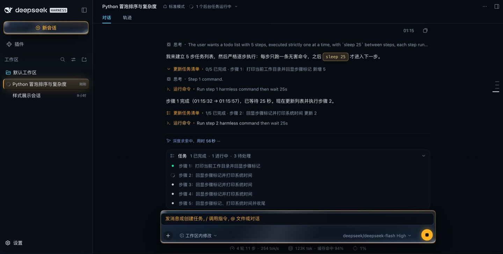
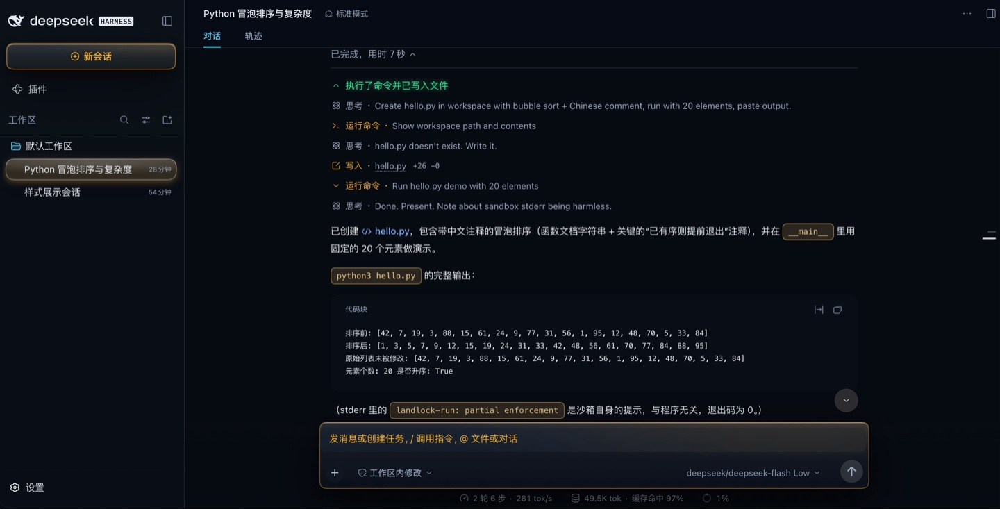
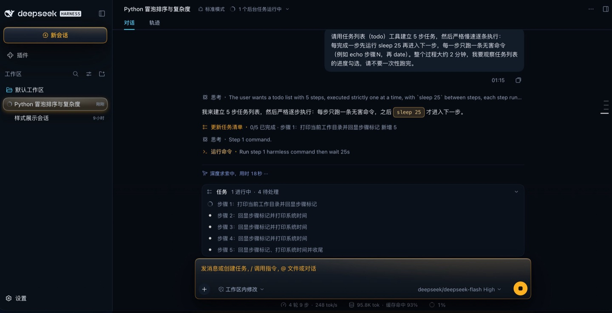

# @dsh-fly/dsh-plugin-fly-skins

**Fly 的四套配色，作为一个标准的 DSH 皮肤插件。**

DeepSeek Harness Web UI 的皮肤插件：`ctx.theme.overrideTokens()` 覆写官方 token 表 +
一份作用域化的 `FLY_CSS`（重画官方 UI 的 chrome 表面）+ 官方「设置 → 通用」里的一行。

| 配色 | id | 风格 |
| --- | --- | --- |
| 实心 | `solid` | 不透明面板，边界清晰（默认） |
| 玻璃 | `glass` | 半透明磨砂 + 发丝描边 |
| 玻璃2 | `volume` | 玻璃体块 + 状态发光 + 文字上板 |
| 霓虹 | `neon` | 场景光场 + 边缘外溢发光 + 文字上板 |

每套都有明暗两半，选择持久化在 profile 的 patch 层（字段 `skin`）。

## 四套配色（真机截图）

会话的步骤链展开后（思考 / 运行命令 / 写入 `hello.py` +26 −0 / 代码块）：

| 霓虹 Neon | 体积 Volume |
| --- | --- |
|  |  |
| **玻璃 Glass** | **实心 Solid** |
|  |  |

四套配色各有明暗两半，上面都是暗色那一半。截图都是**官方 UI 里跑着本包时的实拍**
（真引擎 + 真浏览器，1440 宽 @DPR 2）。

## 安装

```bash
dsh plugin --profile=<profile> add @dsh-fly/dsh-plugin-fly-skins        # npm registry
dsh plugin --profile=<profile> add ./dsh-fly-dsh-plugin-fly-skins-0.1.0.tgz  # tarball
```

**npm 12 起这三条路的代价不一样**（2026-07 的 breaking change：`allowScripts` 默认 off、
`--allow-git` 与 `--allow-remote` 默认 `none`）：

- **npm registry**（上面的第一条）✓ 不需要任何放行，是社区首选；
- **本地 tarball / 本地目录** ✓ 不受影响；
- **git 仓库、远端 tarball URL** ✗ 需要显式放行：`--allow-git` / `--allow-remote`，
  或把它们写进 `package.json` 的脚本白名单（`npm approve-scripts --allow-scripts-pending`）。

（本包自身没有 `preinstall` / `install` / `postinstall` 脚本 ✓，所以 `allowScripts` 默认关闭
不影响安装 ✓。）

在 Harness Web 的**侧栏 → Plugins** 页里也能装（同一个 `plugin_manager`）。装完**重启**
（引擎把客户端包缓存在进程内，刷新页面不够）。

包声明 `dsh.bundle` + `dsh.client`：host 半边贡献一个 Loader 行与开机引导（`__FLY_SKINS__`
全局 + head script），client 半边贡献 token 覆写层、样式表与设置行。

## 运行环境与版本

| 项 | 值 | 说明 |
| --- | --- | --- |
| Harness 引擎 | **`@deepseek-ai/dsh@0.2.0-rc.2`** | 本包在这个版本上验收：`dsh-fly` 的 25 组门禁里 `unit skins` 与 `verify shell`（702 条断言）跑的就是它。引擎**不在依赖里** —— loader 在运行时供给 |
| Node | ≥ 20 | 见 `engines.node` |
| `@deepseek-ai/schemastery` | `^3.18.4`（peer） | host 半边用它声明配置 schema；**在公开 npm 上**（实测 `3.18.4`），`dsh plugin add` 会装它 |
| `@deepseek-ai/dsh-client-*` | 由 loader 供给 | 客户端半边的平台模块（locale / settings / theme / ui-primitives）不进依赖；类型面在 `src/client/platform.d.ts` 里自己声明 |

本包单跑 `pnpm run verify` **不需要引擎**：它的测试自带契约夹具（manifest、loader 行、host 半边、
构建产物指纹）。只有"皮肤在真窗口里画出来了吗"那一层要在 `dsh-fly` 里对着真引擎量 —— 上游改名或大版本
升级时，那边的 `probe:upstream` 会先把候选引擎装到仓库外、跑满门禁再出红表（见其 `docs/upstream-tracking.md`）。

## 两个契约

**开机标记。** 皮肤在 `<html>` 上写 `data-fly-palette="<id>"`（`documentElement.dataset.flyPalette`），
时间点有两个：host 半边的 head script（首帧就不闪，冷启动也带对配色）与 client 半边的 `apply()`。
**工作台插件（`dsh-plugin-fly-shell`）的样式挂在这个标记上** —— 所以两者可以独立安装：
装工作台不装皮肤 = 官方观感 + 工作台照常；装皮肤不装工作台 = 官方 UI 换成 Fly 配色。

**服务面。** client 半边 `ctx.provide('flySkins', { tokens, palettes, palette() })`：

- `tokens`：**本包覆写的那批 token**（名字 → `{ dark, light }`）。消费者用它列出"皮肤改了哪些
  token"，不要自己去遍历 `document.body.style`（那样会顺带列出上游自己的 token）。
- `palettes`：四套配色的 `{ id, label, hint }`（只读）。
- `palette()`：当前配色 id。

宿主行（`dsh-plugin-fly-shell`）按**可选服务**读它（`ctx.get('flySkins')`，不 `inject`）：
皮肤没装时它照常渲染，只是卡片改说「皮肤由 @dsh-fly/dsh-plugin-fly-skins 提供」。别把这条读法改成
`inject`：那会让"只装工作台"的 profile 直接挂不上。

## 开发

```bash
pnpm install
pnpm run verify     # build + typecheck + test —— 提交前请让它全绿
```

改 `src/client/**` **必须**重新构建（`lib/client.js` 是提交进仓库的构建产物，也是打包链真正装的
那份字节）；`tests/freshness.spec.mjs` 拿 bundle banner 里的内容指纹与当前 `src/` 对账，忘了构建
会**直接红**，而不是让"改了没反应"混过去。改完记得在真机上重启 harness 再看界面。

在真机上试装（用一个 scratch profile，别动你在用的那个）：

```bash
dsh plugin --profile=<你的测试 profile> add /绝对路径/dsh-plugin-fly-skins
```

## 目录

```
index.js                  host 半边：Config{skin}（volatile）+ 开机引导（全局 + head script）
cordis.patch.yml          Loader 行（- insert: [{id: fly-skins, name: '@dsh-fly/dsh-plugin-fly-skins'}]）
src/client/tokens.ts      四套配色的 token 表 + paletteOverrides()
src/client/styles.ts      FLY_CSS：重画官方 UI 的 chrome 配方（按 data-fly-palette 作用域）
src/client/index.tsx      client 半边：覆写层、样式表、设置行、flySkins 服务
src/client/platform.d.ts  loader 供给的平台模块的类型面（不 vendor 上游类型包）
scripts/build-client.mjs  构建浏览器半边（vite → factory 形式 CJS）
scripts/lib/client-src-hash.mjs  `src/` 内容指纹（构建写、测试读，一份实现）
tests/contract.spec.mjs   契约（manifest/loader/host 半边/构建产物/归属/对比度）
tests/panel.spec.mjs      设置行的渲染与写回
tests/freshness.spec.mjs  陈旧守卫（bundle 是否用当前 src/ 构建）
lib/client.js             构建产物（`pnpm run build`，提交进仓库）
```

## 改这个包时

- **钩子只认局部类名 / `data-*`**（`[class$='_X']`、`[data-tool]`…），写死 hash 名是 bug；
  上游改名时断言必须**大声红**，禁止"命中 0 就跳过"。
- **注释里不许出现反引号**：`styles.ts` 的 CSS 在模板字符串里，一个反引号就让构建**静默失败**
  （验证于是读到旧皮肤）。改完先看构建退出码。
- **只画官方 UI，不碰工作台**：`.fly-*` 与 `data-fly-shell` 是 `dsh-plugin-fly-shell` 的标记，
  本包的 `tests/contract.spec.mjs` 有一条反向断言盯着。
- **只读 token 的断言会假绿**：token 解析对 ≠ 那层真的被画出来。改视觉要量**合成像素**
  （端到端那一组同时装两个包，见 `dsh-fly` 仓库的 `packages/dsh-plugin-fly-shell/scripts/verify-shell.mjs`）。

## 这个包怎么被 `dsh-fly` 用

本包不属于 `dsh-fly` 那个仓库的 `packages/`（它住在这里，就是这个仓库存在的理由：**改动以 PR 的
单位进来**）。`dsh-fly` 通过它自己的 `plugins.lock.json` 认这个仓库：

```jsonc
// dsh-fly/plugins.lock.json
{ "plugins": { "@dsh-fly/dsh-plugin-fly-skins": { "repo": "…", "version": "0.1.0", "path": "dsh-plugin-fly-skins", "sha": "…" } } }
```

| 那边做的事 | 走什么 |
| --- | --- |
| 找到本包 | `$FLY_PLUGINS_DIR`，缺省 `<dsh-fly 仓库的上一级>/dsh-plugins` —— 所以把本仓库 clone 到那儿，或设那个环境变量 |
| 构建客户端半边 | `pnpm build:clients` 会连着本包一起重出（用同一份 builder），产出的 `lib/client.js` **提交在这个仓库里** |
| 跑本包的门禁 | `unit skins` 组：`dsh-fly` 的 25 组门禁里那一组跑的就是本包的 `tests/` |
| 打包 | 桌面版把本包一起打进 `fly-packages/`（DMG 里不缺它） |
| 解析依赖 | 本仓库要自己 `pnpm install` 过：`dsh plugin add` 在 profile 里建的是软链，Node 从真实路径解析 |

**两条你会踩到的规矩**：

1. **改版本号要同步锁**：`package.json` 的 `version` 一动，`dsh-fly` 那边 `plugins.lock.json`
   的对应值要一起改，否则它的门禁**开跑前**就退 4（带着本仓库的路径）。提交本身不用锁（锁里的
   sha 只要是这个仓库 HEAD 的祖先就行 —— "领先锁"是 co-develop 的常态，那边会如实报出来）。
2. **共享的构建件不许各自改**：`scripts/build-client.mjs` 与 `scripts/lib/client-src-hash.mjs`
   在这两个仓库里必须**逐字节相同**（那边有一条断言盯着）。要动它们就两个仓库一起动，
   否则会出现"本包按自己的口径构建、那边的守卫按自己的口径比"—— 症状是门禁全绿而屏幕上是旧皮肤。

## 发布（维护者）

```bash
pnpm run verify        # 先绿（构建 + tsc + 全部测试）
npm login --registry=https://registry.npmjs.org/    # 首次；CI 里用 NPM_TOKEN
npm publish            # publishConfig 已把 registry 钉在公开 npm 上
```

- **`publishConfig.registry` 是必须的**：本机与公司环境的 npm 默认 registry 可能是内网镜像，
  少了它 `npm publish` 会朝镜像发 —— 发不出去还算好，真发出去了更糟。
- 包名带 scope：`@dsh-fly/dsh-plugin-fly-skins`，scope 由 npm 组织 `dsh-fly` 拥有
  （**发布前先在 npm 上建好这个 org**）。`package.json` 里已有 `"publishConfig": {"access": "public"}`。
- **为什么要 scope**（2026-10-08 决定）：granular token 的 "Select packages" **只能挑已存在的包**，
  所以"一个 token 覆盖将来才建的兄弟插件"只能靠 `--scopes dsh-fly` 授权 —— 而 scope 授权的前提
  是包名真的在 scope 下。npm **不允许给已发布的包改名**，所以这个决定必须在第一次发布之前做。
- **第一次发布别用"限定到具体包"的 granular token**：那孩子只能选包，而全新包恰恰还不存在。
  用 `npm login`（或 `All packages` 的 granular / classic Automation token）先把名字占下来；
  存在之后再收紧到 `--packages @dsh-fly/dsh-plugin-fly-skins` 或 `--scopes dsh-fly` 交给 CI。
- 版本号一动，**同步 `dsh-fly` 的 `plugins.lock.json`**（那边门禁开跑前会核对，对不上直接退 4）。
- 发完拿 scratch profile 验一次真实安装：`dsh plugin --profile=<测试 profile> add @dsh-fly/dsh-plugin-fly-skins`。

发布出去以后，社区有三条消费路径，按需要选：**npm registry**（`dsh plugin add @dsh-fly/dsh-plugin-fly-skins`）、
**tarball**（`npm pack` 出来的 `.tgz`，离线/内网可用；本地文件不受 npm 12 的 `allow-remote` 影响 ✓）、
**兄弟仓**（clone 到 `dsh-fly` 上一级的
`dsh-plugins/`，那边按 `plugins.lock.json` 解析 —— dsh-fly 自己走的就是这条）。

## 许可证与来源

[MIT](LICENSE)。本项目按 [CONTRIBUTING.md](CONTRIBUTING.md) 接受 PR —— 那里的三条规矩与
"怎么证明你改对了"是评审会看的清单。

第一版内容从 `dsh-fly` monorepo 的 `packages/dsh-plugin-fly-skins` 拆出（该仓库 `20698e8` 时
它成为一个独立包）；`scripts/build-client.mjs` 与 `scripts/lib/client-src-hash.mjs` 是那份仓库里
同名文件的逐字节副本，两份由 monorepo 的断言盯着不许漂移。
