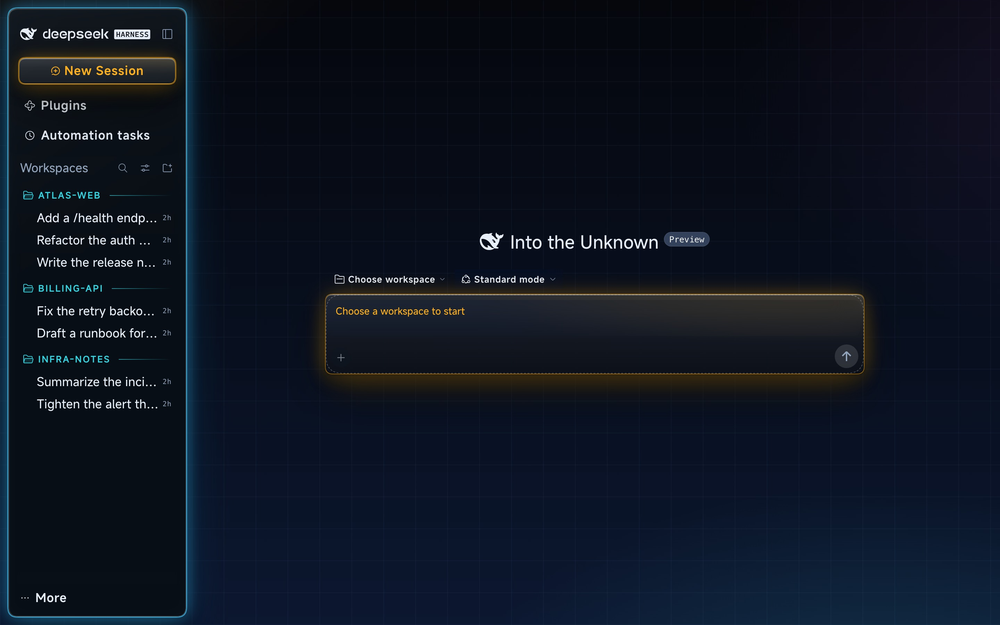
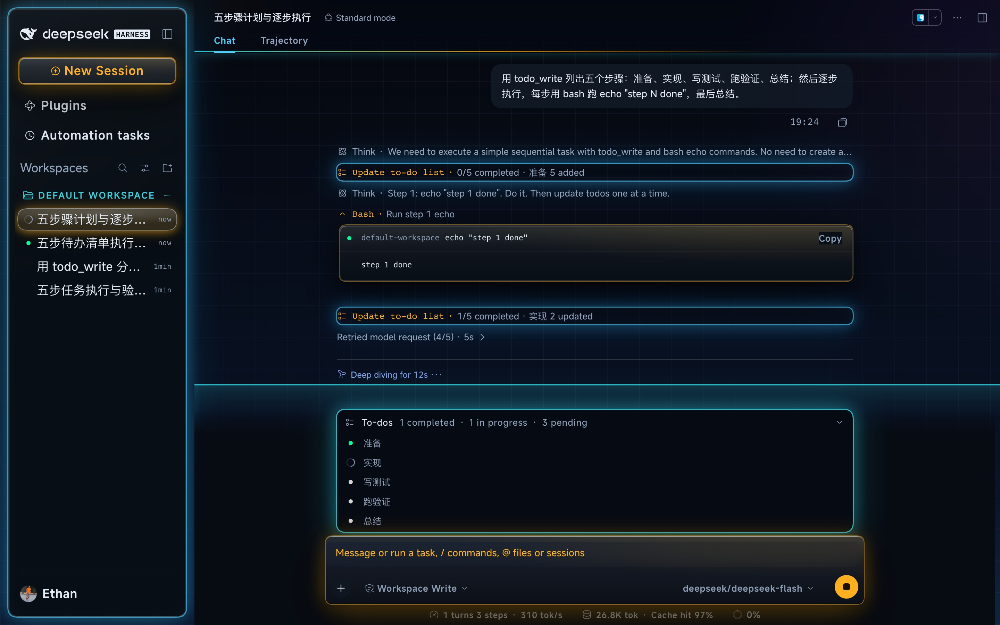
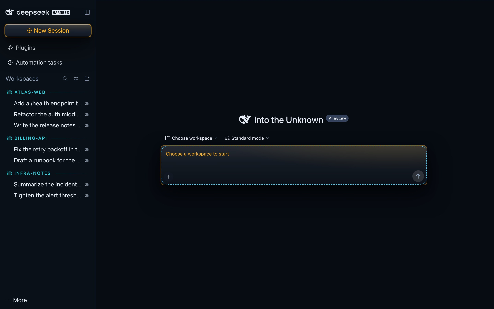
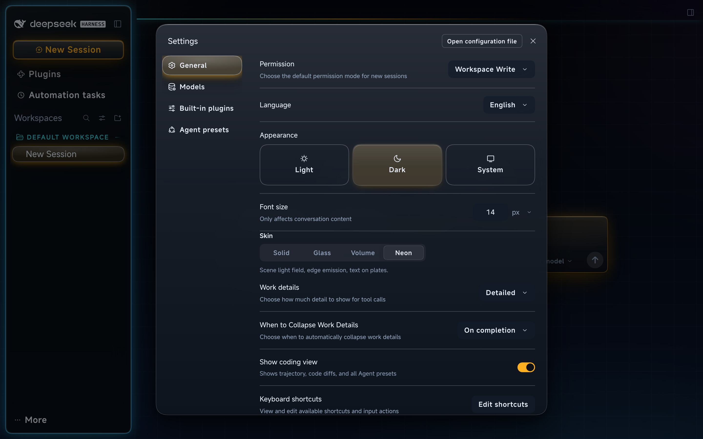
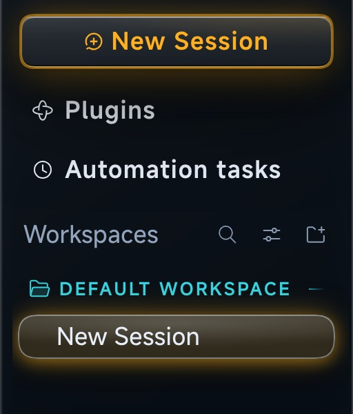

# Fly Skins — palettes for the DeepSeek Harness web UI

**A standard DSH skin plugin: four palettes, light and dark halves, a laser scan while the model
works, and a 125% sidebar type scale.**
**标准 DSH 皮肤插件：四套配色（各含明暗两半）、模型运行时的激光扫描、外加 125% 的侧栏字号。**

`@dsh-fly/dsh-plugin-fly-skins` · category **theme** · MIT

> Previews below are the **official DeepSeek Harness UI with this skin installed** — no Fly
> workbench, a fresh profile. The workspaces and sessions shown are **sample data**
> (`atlas-web` / `billing-api` / `infra-notes`); no real conversations appear.
> 下面的预览图是**官方 DeepSeek Harness UI + 本皮肤**（没有 Fly 工作台、全新 profile）；
> 侧栏里的工作区与会话是**示例数据**（atlas-web / billing-api / infra-notes），不含任何真实会话。

## Neon — the flagship palette

A scene light field behind the whole window: deep navy canvas, a 46px circuit grid running edge
to edge, cyan edge-glow bleeding out of the rail card, and text sitting on its own plate so it
stays sharp over the field. Dark and light are two halves of the same recipe, not two themes.

**霓虹是主打配色**：整窗一张场景光场（深蓝画布 + 46px 电路网格）、栏卡外溢青光、
文字坐字座；明暗两半是同一套配方的两个半区，不是两套主题。



### Laser scan while the model works

When a turn is running, a 2px cyan line sweeps bottom-to-top through the conversation column,
trailing a 48px glow in the same cyan as the todo panel's ring. It is tied to the harness's own
running marker (`data-chat-running`): the line exists only while the model is working and is
gone the moment the turn settles — idle reading never gets a moving line. Off under
`prefers-reduced-motion` and at ≤768px.

**模型工作时才扫**：2px 的青线自下而上扫过中列，尾迹 48px、与 Todo 任务列表卡同一颗青。
线挂在引擎自己的运行标记（`data-chat-running`）上——模型一停就消失，静态翻阅时不扫；
`prefers-reduced-motion` 与 ≤768px 下关闭。

预览图是一次**真实的示例任务**（`todo_write` 列出五步、每步跑一句 `echo "step N done"`）
进行中拍的：底部是**展开的 todo 卡**（准备 ◐ / 实现 · / 写测试 · / 跑验证 · / 总结 ·），
中间上方是**展开的命令卡**（第一步的 bash 调用与输出），todo 卡**上方那条空带里**
横贯画面的青光就是扫描线（16 秒一程的动画，抓帧时停在空带里，不压任何文字）。
The frame is a real capture of a harmless five-step example task in progress
(`todo_write` + one `echo` per step): the todo card at the bottom is expanded (one done, one in
progress, three pending), the command card in the middle is step 1's `bash` call and output, and
the line between them is the scan. It is sample content, not the owner's conversations.



### Sidebar as a HUD

Workspace folders are drawn as cyan HUD plates — uppercase, 13px, 600 weight, 0.12em tracking,
a tinted plate and a 1px fading tail line — so a folder heading no longer reads as one more
session row between two groups. Session rows keep the plain 17.5px white type and the pill
selection; nothing about them moved.

**侧栏做成 HUD**：工作区文件夹名是青色标牌（大写、13px、600、0.12em 字距、淡青底板 +
1px 渐隐尾线），不再夹在两段会话中间像一条会话行；会话行一个字没动。

### Type

Latin is MiSans Latin, embedded (~166KB, Apache-2.0, three weights) so the chrome keeps its HUD
voice offline; Chinese falls back to your own font setting, which the recipe deliberately keeps.
Buttons and panel titles take 600 weight with 0.04em tracking, section labels 500, numerals are
tabular, and timestamps/counts switch to the mono stack.

**字体**：拉丁用内置的 MiSans Latin（约 166KB，Apache-2.0，三档字重），中文回落到你自己的
字体设置；按钮与面板标题 600 + 0.04em，section 标签 500，数字等宽，时间戳/计数走等宽字体。

## Four palettes

| Palette | id | Look | Pick it when |
| --- | --- | --- | --- |
| **Solid** | `solid` | Opaque panels, crisp borders | You want a flat, high-contrast room |


| **Glass** | `glass` | Translucent frosted surfaces, hairline edges | You want depth without colour |
| **Volume** | `volume` | Glass volume + state glow + text plates | You want the lit, sculpted read |
| **Neon** | `neon` | Scene light field + edge glow + text plates + running scan | You want the battle-room look (default in dsh-fly) |

Every palette has a light and a dark half. The choice persists in the profile's patch layer
(field `skin`), so it survives restarts and profile switches.

## Install

```bash
dsh plugin --profile=<profile> add @dsh-fly/dsh-plugin-fly-skins
```

Or add it from **Settings → Plugins** in the harness UI, then **restart** the app — the engine
caches client bundles in-process, so a page refresh is not enough.

Once installed, the palette picker appears as its own row in **Settings → General**:



It works standalone: install the skin without the Fly workbench and you get the official UI in
Fly colours; install the workbench without the skin and you get the official look plus the
workbench.

## Neon scanline and typography (0.2.0, refined through 0.2.4)

The neon dark half carries a slow **bottom-to-top scanline**: a **2px** laser in the Todo task-list
panel's cyan-green, `rgba(53, 211, 224, 0.78)` (the T10 ring; `#35d3e0`), with a 48px tail that
trails below the line, painted on the centre column's background — i.e. *behind* messages and
cards, so it never washes over text. It sweeps upward for about 16 seconds, holds offscreen at
both ends, and restarts invisibly. The layer is mounted **only while a turn is running**: the rule
is chained to the upstream `[data-chat-running]` row that React mounts for the active turn and
unmounts when the model stops. Idle conversations and the home therefore stay still — the scan is a
"working" signal, not a screensaver. The light half does not scan (a moving line on a white field
reads as dirt), and the layer is removed entirely under `prefers-reduced-motion: reduce` and on
screens at or below 768px.

**霓虹深色半区新增一条自下而上的扫描线**：2px 激光，颜色取 Todo 任务列表卡 T10 边框的 `rgba(53,211,224,.78)`（#35d3e0，青光绿），+ 48px 柔尾迹（拖在线下方），画在中列背景、消息与卡片的**下面**；
约 16 秒扫完一程，两端在屏外静默后重播。**只在该会话 running 时挂载**：规则挂在上游
`[data-chat-running]` 的运行状态行上，模型一停这行就卸载，线也一起消失；空闲会话和首页不扫。
浅色半区不扫（白底上会显脏），`prefers-reduced-motion` 与 ≤768px 小屏自动关闭。

The Latin chrome now uses **MiSans Latin** (three weights, about 166 KB, embedded in the client
bundle, Apache-2.0; see `LICENSES/`). Buttons and panel titles take weight 600 and 0.04em tracking,
section labels weight 500, and numbers are tabular. Chinese text keeps the user's own font setting —
the full MiSans CJK family is about 45 MB of sharded woff2, which a desktop security tool should not
download or carry. The family is scoped to neon; solid / glass / volume keep their exact shipped
type and pixels.

**拉丁字形换成内置的 MiSans Latin**（三字重，约 166KB，随客户端包内嵌，Apache-2.0）；中文继续用
用户自己的字体设置。字重、字距与 tabular 数字只作用于霓虹，其余三套配色保持原样。


## Sidebar workspace hierarchy (0.2.6)

All four palettes used to paint the workspace folder name with the same
`--dsw-alias-label-primary` ink and 14px type as the session rows. Once the
sidebar type grew to 17.5px, a folder wedged between the previous workspace's
last session and its own first session had no cue but the small folder glyph.

The B treatment makes the folder a **HUD badge**: pending cyan (`#35d3e0` dark /
`#0f6f7d` light), 13px, weight 600, 0.12em tracking, uppercase Latin, with the
folder icon in the same cyan and a 1px trailing gradient rule. 13px is
deliberate: 14px clipped `DEFAULT WORKSPACE` to `DEFAULT WORKSP…` in the 280px
rail, so the badge keeps the full label while still sitting one step below the
17.5px session rows. The row keeps upstream's plate/radius/hover; the A+C gold
plate and bar are gone. Sessions are untouched — 17.5px, white 400, pill
selected. Chinese names do not uppercase; cyan, tracking and the rule carry the
cue. The rule keys on the upstream `projectRow` / `_title` / `_folder` local
hooks and is shared by solid, glass, volume and neon.

**四个主题的左侧会话栏原先都把工作区文件夹名画成和会话行同一个
`--dsw-alias-label-primary` / 14px**；侧栏字号抬到 17.5px 后，夹在上一个
工作区会话尾部和本工作区会话头部之间的文件夹名只剩一个小图标可辨。B 把
工作区行做成**青色 HUD 标牌**：pending 青（深色 #35d3e0 / 浅色 #0f6f7d）、
13px、600、0.12em 字距、英文大写，文件夹图标同青色，右侧一条 1px 渐隐细线。
**13px 是有意的**：14px 会把 `DEFAULT WORKSPACE` 截成 `DEFAULT WORKSP…`
（280px 轨道实测），所以保留完整标签，只比 17.5px 的会话行低一档。行的底板/
圆角/hover 交还上游，A+C 的金底板和金条已撤；会话行一个字都不动（17.5px
白字 400、胶囊选中态）。中文没有大小写，靠青色、字距和细线区分。规则认上游
`projectRow` / `_title` / `_folder` 局部名，四个 palette 共用。



## Sidebar type scale

The left rail keeps its 100% width and its text is set at **125%** (14px → 17.5px) in every
palette, on both light and dark halves. The rail does not take part in window zoom, so the type
stays the same size while the conversation area scales.

## Compatibility

| Item | Value |
| --- | --- |
| Harness engine | `@deepseek-ai/dsh@0.2.x` (verified on `0.2.0-rc.2` and `0.2.1-rc.2`) |
| Node | ≥ 20 |
| Peer | `@deepseek-ai/schemastery` `^3.18.4` (the engine supplies the rest at load time) |

The package declares `dsh.bundle` + `dsh.client`: the host half contributes a loader row and a
boot-time palette marker; the client half contributes the token override layer, the stylesheet
and the settings row.

## Development & internals

Everything about building, the two contracts (boot marker and the `flySkins` service), the
directory layout, the upstream-hook rules, how `dsh-fly` consumes this repo, and the release
checklist lives in **[docs/maintainers.md](docs/maintainers.md)**.

```bash
pnpm install
pnpm run verify     # build + typecheck + tests
```

## License

[MIT](LICENSE). First split out of the `dsh-fly` monorepo (`packages/dsh-plugin-fly-skins`);
`scripts/build-client.mjs` and `scripts/lib/client-src-hash.mjs` are byte-identical copies of the
ones there, guarded by assertions on both sides.
