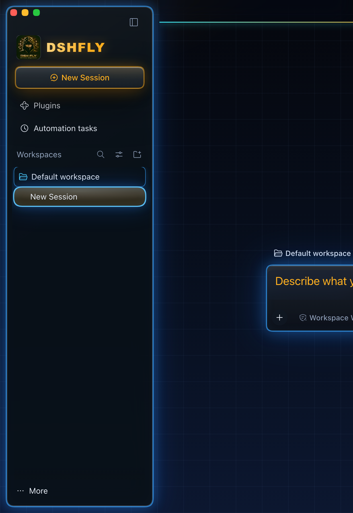
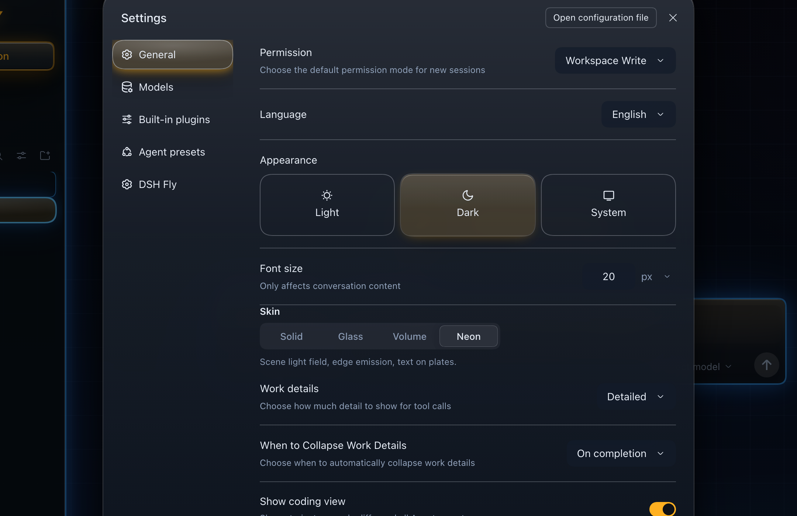
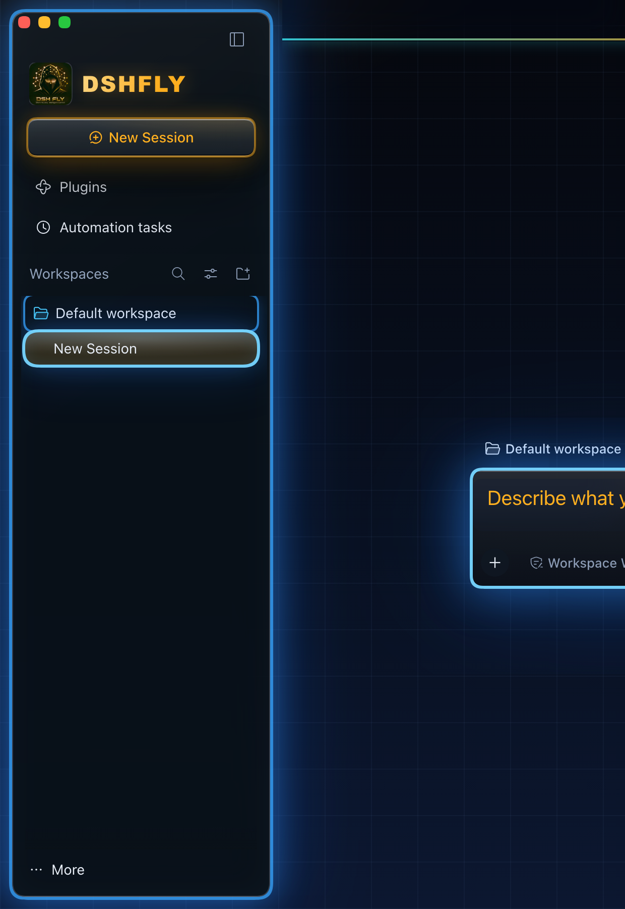
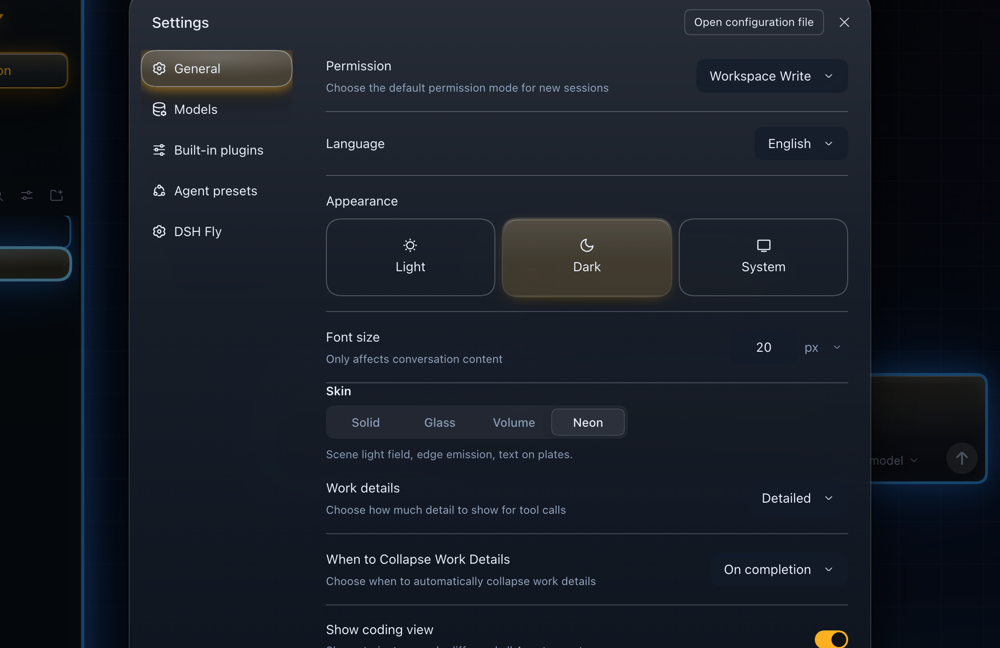

# 设计稿 · neon 科幻化第二轮 ——「强发光」（蓝边加粗 + 光晕加强）

> 2026-10-18。第一轮（网格场 + HUD 取景框，见 [`../neon-scifi/`](../neon-scifi/)）方向被否。
> 用户给了两个参考点，这一轮就按它做：
> 1. **发光类组件**（任务栏列表卡、输入卡…）——蓝色发光边框**加粗**，光晕**加强**；
> 2. **左侧会话栏的卡片边框**也要吃发光。
>
> 范围：只动 neon 深色半区；solid/glass/volume 与浅色半区不动。

## 1. 做法（一句话）

**不写 `border`，只用 `box-shadow` 叠环**：`0 0 0 Npx` 做出"加粗的蓝边"（不加布局、不挪内容），
再叠中晕 / 远晕 / 内辉三层。这样"边框变粗"和"光晕变强"是两个独立旋钮，可以分别调。

| 层 | 作用 | A（常亮） | B（呼吸） |
| --- | --- | --- | --- |
| 近环 `0 0 0 Npx` | 视觉上的"粗边框" | 2px | 3px |
| 中晕 `0 0 22/34px` | 主要光晕 | 22px | 34px |
| 远晕 `0 0 56/88px` | 外溢感 | 56px | 88px |
| 内辉 `inset 0 0 26px` | 让板内也有光 | 26px | 34px |
| 动效 | 呼吸（选中行） | 无 | 4.2s，只在 `no-preference` 下 |

## 2. 对照图（真页面注入 CSS 后截，红绿灯为叠加色块）

| | 侧栏 | 设置弹窗 |
| --- | --- | --- |
| 现状 |  |  |
| A · 常亮 |  |  |
| B · 呼吸 |  |  |

## 3. 哪些面吃光

| 面 | 钩子 | A | B |
| --- | --- | --- | --- |
| 左侧会话栏卡片 | `[class$='_frame']:has(> [class*='sidebarCol']) [class*='sidebarCol']` | 2px 环 + 22/56px 晕 + 内辉 | 3px 环 + 34/88px 晕 + 内辉 |
| 会话行（选中） | `[class*='sessionRow'][class*='selected']` | 2px 亮环 + 18/42px | 3px + 30/64px + 呼吸 |
| 会话行（常态）/ 工作区行 | `[class*='sessionRow']:not([class*='selected'])` / `[class*='projectRow']` | 1px 环 + 12px | 2px + 18px |
| 面板行（Plugins 等） | `[class*='_panelRow']:hover` | 1px + 16px | 2px + 22px |
| 输入卡 / 工具卡 | `[class*='composerStack'] [class*='_card']` / `[class*='_ioCard']` | 2px + 26/64px | 3px + 36/92px（focus-within 再扩） |
| 键盘焦点 | `:is(button,a,[role='button'],input,textarea):focus-visible` | 2px 环 + 20px | 3px + 28px |

## 4. token（深色半区）

| CSS（设计稿） | 入库名 | A | B |
| --- | --- | --- | --- |
| `--fly-glow-core` | `--dsw-specific-fly-glow-core` | `rgba(96,200,255,.92)` | `rgba(120,214,255,.95)` |
| `--fly-glow-ring` | `--dsw-specific-fly-glow-ring` | `rgba(58,168,255,.62)` | `rgba(58,168,255,.72)` |
| `--fly-glow-near` | `--dsw-specific-fly-glow-near` | `rgba(46,146,255,.38)` | `rgba(46,146,255,.48)` |
| `--fly-glow-far` | `--dsw-specific-fly-glow-far` | `rgba(34,118,255,.22)` | `rgba(34,118,255,.28)` |
| `--fly-glow-inner` | `--dsw-specific-fly-glow-inner` | `rgba(96,200,255,.10)` | `rgba(120,214,255,.14)` |

## 5. 已知坑（这一轮实测踩到的）

1. **特异性不够 = 整条规则静默失效**。皮肤自己的卡片/行规则用的是
   `html[data-fly-palette='neon'] … :not([data-sidebar-collapsed]) > [class*='sidebarCol']`
   这类形状，第一版本稿只写 `html[data-fly-palette='neon'] … [class*='sidebarCol']`，
   算下来特异度更低 —— 量到的 `box-shadow` 是皮肤的 slab 阶梯，**光一条都没画**。
   修法：本稿所有规则加 `body[data-ds-dark-theme]` 前缀（与皮肤深色半区同作用域、更高一级）。
2. **frame 有 `overflow: hidden`**：卡片外晕在窗口边缘会被裁，12px 的卡片外边距就是光晕能露出的全部宽度。
   所以"外晕加强"更多体现在**环形亮度 + 内辉**上；若要更大外溢，得改 frame 的裁剪（不属于本轮）。
3. **`[class*='_newSession']` 双命中**（`button.newSession` 与 `span.newSessionLabelMask`），
   按钮规则必须收窄到 `button`，否则内部多一个方框（第一轮同样踩过）。
4. **CTA 保留暖光**：New Session 是品牌按钮，蓝光只给"表面/行/卡"，暖光留给动作钮 ——
   两者并置时读起来是"界面冷、动作热"。若你要全冷，改 `button[class*='_newSession']` 一条即可。

## 6. 风险

| 风险 | 现状 / 处置 |
| --- | --- |
| 多层大半径 shadow 在 1× 外接屏显糊 | A 的远晕 56px 是上限；B 88px 只建议在 2× 屏用。落地后按 2560×1440 实拍复核 |
| 常亮发光过多 → 整屏发蓝、层次丢失 | 常态只有 1–2px 环 + 12px 晕；**大光晕只给选中/输入卡** |
| 呼吸动画干扰阅读 | 只在 `prefers-reduced-motion: no-preference` 下开；幅度只动光晕，不动环宽 |
| 浅色半区 | 不做（白底蓝晕会糊）；浅色半区第二轮单独设计 |

## 7. 落地映射

1. `src/client/tokens.ts`：把选中强度的 5 颗 `--dsw-specific-fly-glow-*` 并进 `NEON_DARK`；
2. `src/client/styles.ts`：把选中变体里除 token 声明块外的规则搬进 neon 深色段，
   `--fly-glow-*` 按 §4 换成入库名（逐字节一致，`scripts/verify-design-tokens.mjs` 会钉住）；
3. `scripts/verify.mjs` 建议补的断言：
   - 侧栏卡的 `box-shadow` 含 `0 0 0 2px`（或 3px）与至少两层外晕 → "蓝边加粗 + 光晕"真的画了；
   - 选中行的 `box-shadow` 与常态行**不同**（否则光只是画在同一层）；
   - `prefers-reduced-motion: reduce` 下 `animation-name === 'none'`；
4. `docs/shots/` 补两张画廊图。

## 8. 等你裁决

- **A 还是 B**（常亮 / 呼吸）；
- 是否要 **CTA 也转蓝**（现在是冷界面 + 暖按钮）；
- "任务栏列表卡"如果指的是**对话里的任务/工具卡片**，请指一张截图，我把 `_ioCard` 那组按同样强度对齐（本轮已带上通用规则，但没能在空会话里实拍验证）。
