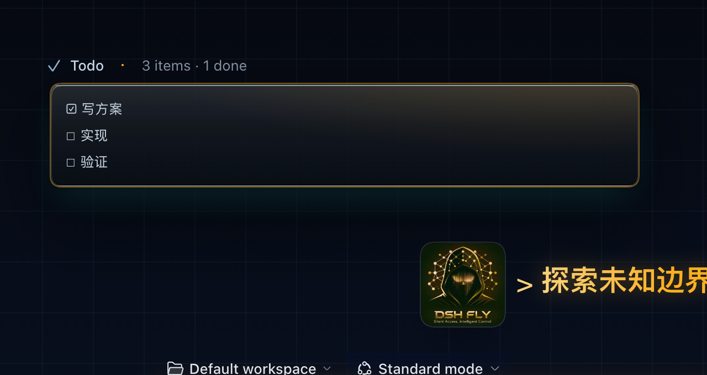
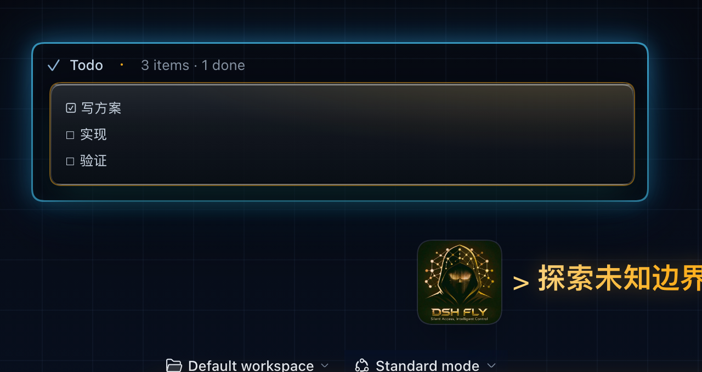
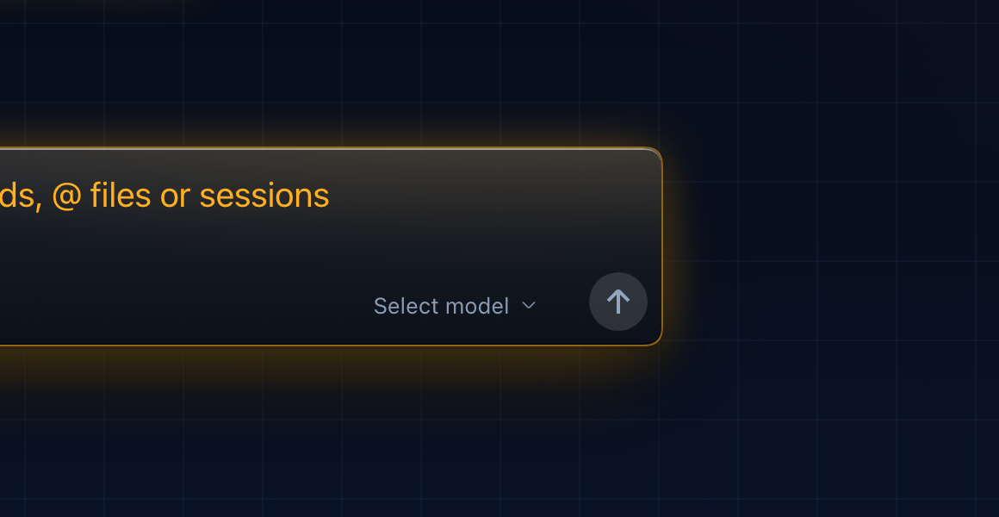
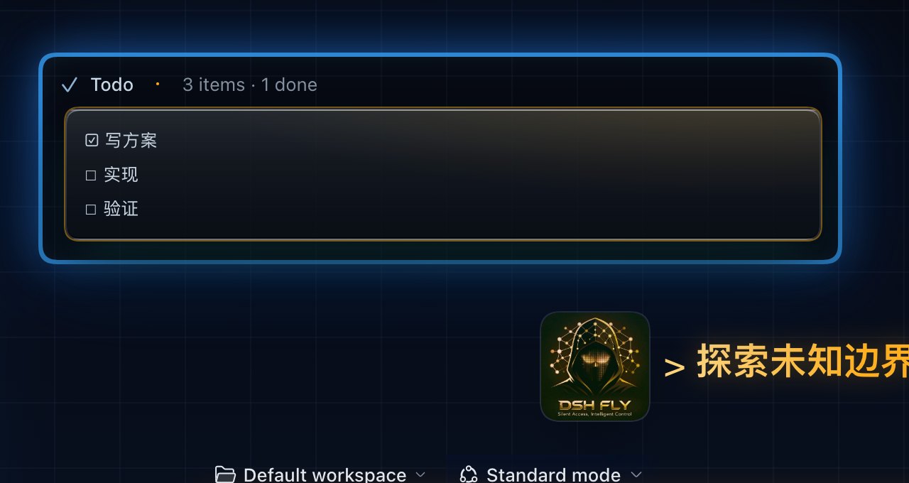

# 设计稿 · neon 科幻化第二轮 ——「强发光」（蓝边加粗 + 光晕加强）

> **已裁决（2026-10-18）：采用方案 A（常亮）。** 方案 B 的 3px 边框被用户判为"过于粗"，
> 保留在仓库里仅作历史对照，不再落地。
>
> 2026-10-18。三轮裁决后的最终范围：
> **只给两处发光**：① 左侧栏的**卡片边框**；② **对话流里的待办 / 计划卡**（`todo_write` 工具卡）。
> 其余表面一律不发光 —— 这是用户明确约束，别"顺手"扩散。

## 1. 范围（这张表就是验收口径）

| 表面 | 发光 | 钩子 | 依据 |
| --- | --- | --- | --- |
| 左侧栏卡片边框 | ✅ | `[class$='_frame']:has(> [class*='sidebarCol']) [class*='sidebarCol']` | 已有钩子 |
| 对话流的待办 / 计划卡 | ✅ | **`[data-tool='todo_write']`** | 上游 `dsh-client-ui-tool` 的 `ToolRow` 根节点带 `data-tool={toolName}`（源码实证，不用哈希类名） |
| 工作区输入框（composer） | ❌ | —— | 保持原生暖光（见 `shots/*-composer.png`） |
| 会话选中胶囊 / 工作区行 / 面板行 | ❌ | —— | 保持原生 |
| 自动化任务抽屉里的卡 | ❌ | —— | 上一版误把它当成"任务列表卡"，已撤掉 |
| 键盘焦点环 | ❌ | —— | 不改动 |

> 术语对齐：**"任务列表卡" = 对话里 `todo_write` 工具渲染的那张待办 / 计划卡**，不是右侧抽屉
> 「Automation tasks」面板，也不是会话 hover 的小任务条。

## 2. 做法

**不写 `border`，只用 `box-shadow` 叠环**：`0 0 0 Npx` 做"加粗的蓝边"（不改布局、不挪内容），
再叠中晕 / 远晕 / 内辉。"边框粗细"和"光晕强度"是两个独立旋钮。

| 层 | A（常亮） | B（呼吸） |
| --- | --- | --- |
| 近环 | 2px | 3px |
| 中晕 | 22px（栏卡）/ 20px（待办卡） | 34px / 28px |
| 远晕 | 56px / 48px | 88px / 68px |
| 内辉 | 26px / 18px | 34px / 24px |
| 动效 | 无 | 待办卡 hover 2.6s 呼吸（仅 `no-preference`） |

## 3. 对照图

| | 侧栏（只栏卡发光） | 待办卡（夹具） | 输入框（必须无蓝光） |
| --- | --- | --- | --- |
| 现状 |  |  |  |
| A · 常亮 |  |  |  |
| B · 呼吸 |  |  |  |

## 4. token（深色半区）

| CSS（设计稿） | 入库名 | A | B |
| --- | --- | --- | --- |
| `--fly-glow-core` | `--dsw-specific-fly-glow-core` | `rgba(96,200,255,.92)` | `rgba(120,214,255,.95)` |
| `--fly-glow-ring` | `--dsw-specific-fly-glow-ring` | `rgba(58,168,255,.62)` | `rgba(58,168,255,.72)` |
| `--fly-glow-near` | `--dsw-specific-fly-glow-near` | `rgba(46,146,255,.38)` | `rgba(46,146,255,.48)` |
| `--fly-glow-far` | `--dsw-specific-fly-glow-far` | `rgba(34,118,255,.22)` | `rgba(34,118,255,.28)` |
| `--fly-glow-inner` | `--dsw-specific-fly-glow-inner` | `rgba(96,200,255,.10)` | `rgba(120,214,255,.14)` |

## 5. 已知坑（实测）

1. **范围错了两轮**：第一轮理解成"所有卡"（composer、会话胶囊被点亮，被否）；第二轮理解成
   右侧抽屉「Automation tasks」面板。**设计前必须先跟用户对齐"哪一处"，并写出"不发光清单"**。
2. **待办卡的锚是 `data-tool`**：上游 `ToolRow` 根节点是
   `div[data-variant][data-tool][data-state]`，类名是哈希（`.o3BgMG_root`）。写 `[data-tool='todo_write']`
   既稳又不用碰哈希。
3. **本机 scratch profile 造不出真实会话**：模型走 `llm-mioffice`，子进程里没有
   `LLM_MIOFFICE_API_KEY`（报 `MISSING_CREDENTIAL`），所以待办卡截图是**夹具**（按 ToolRow 真实结构搭）。
   **落地后必须用真实会话复拍一张**再定强度。
4. **特异性不够 = 整条规则静默失效**：皮肤自己的卡/行规则带 `:not([data-sidebar-collapsed]) >`
   这类形状，本稿第一版少一颗属性，读回的 `box-shadow` 还是皮肤原值；修法是加
   `body[data-ds-dark-theme]` 前缀。
5. **frame 的 `overflow: hidden`** 会裁栏卡外晕：12px 卡片外边距就是外晕能露的全部宽度。
6. **待办卡内部还有一张 `_ioCard`**：它自带霓虹的暖色发丝边，蓝环是加在**外层 ToolRow** 上的；
   两层边并置是否好看需要真机确认（若要求"整卡统一蓝"，得同时改内层描边，属于落地细节）。

## 6. 风险

| 风险 | 处置 |
| --- | --- |
| 多层大半径 shadow 在 1× 外接屏显糊 | A 的 56/48px 是上限；B 建议只用于 2× 屏，落地后按 2560×1440 复拍 |
| 待办卡在会话里出现多张 → 整屏发蓝 | 光晕只给这两处；同屏多卡时若过亮，把远晕从 48px 收到 32px |
| 呼吸动画干扰阅读 | 仅 `no-preference`；只动光晕不动环宽 |
| 浅色半区 | 不做（白底蓝晕会糊） |

## 7. 落地映射

1. `src/client/tokens.ts`：选中强度的 5 颗 `--dsw-specific-fly-glow-*` 并进 `NEON_DARK`；
2. `src/client/styles.ts`：把选中变体里除 token 声明块外的规则搬进 neon 深色段，
   `--fly-glow-*` 换成入库名（`scripts/verify-design-tokens.mjs` 逐字节钉住）；
3. `scripts/verify.mjs` 建议补的断言：
   - 栏卡 `box-shadow` 含 `0 0 0 2px/3px` 且至少两层外晕；
   - `[data-tool='todo_write']` 的 `box-shadow` 含环 + 外晕；
   - **反向**：composer 与 sessionRow 的 `box-shadow` 与改前逐字节相同（范围不许扩散）；
   - `prefers-reduced-motion: reduce` 下 `animation-name === 'none'`；
4. `docs/shots/` 用**真实会话**补两张画廊图。

## 8. 裁决与落地状态

| 事项 | 结论 |
| --- | --- |
| 方向 | **A（常亮 2px 环）** —— 用户裁决；B 的 3px 边框"过于粗"，仅留档 |
| 落地 | ✅ `src/client/tokens.ts`（5 颗 `--dsw-specific-fly-glow-*`）+ `src/client/styles.ts`（栏卡 + `[data-tool='todo_write']`） |
| 待办卡内层 `_ioCard` 的暖色描边 | 暂保持暖色（外侧蓝、内侧暖），待真机复拍再定 |
| 真实会话复拍 | 未做（本机 scratch profile 无模型凭证） |

### 落地时踩到的两个坑

1. **`box-shadow` 会覆盖，不会叠加**：栏卡原本有一套 8 层立体阶梯（亮缘 + 压暗底 + 阴影 + 青色环境光，
   由 `verify-shell` 的「栏卡边缘方言」断言守着）。设计稿直接写一条新的 `box-shadow` 会把整阶梯冲掉，
   所以落地时是把 4 层蓝光**追加**在那条声明的**前面**（见 `styles.ts` 的注释）。
2. **每个调色板必须画同一套 token 名**：只往 `NEON_DARK` 加 5 个键，`contract.spec` 的
   「每个调色板画同一套 token」立刻红（实测 90 !== 85）。修法是加一个 `GLOW_OFF`（全 transparent）
   常量，六个非 neon 调色板各展开一份，neon 深色再用蓝色真值覆盖。
