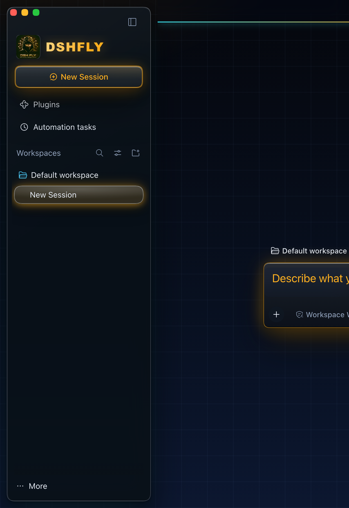
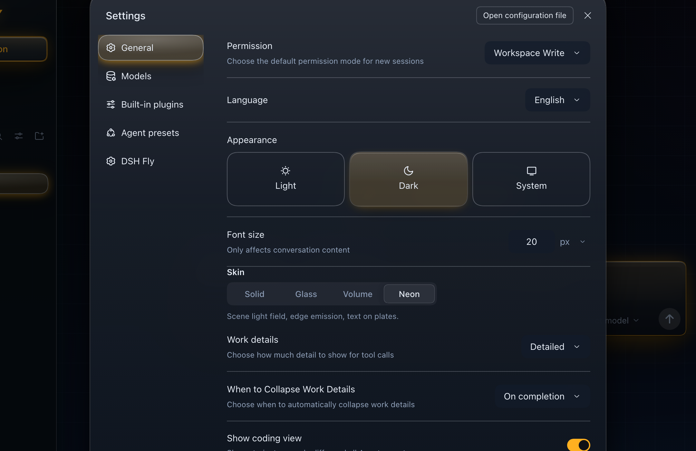
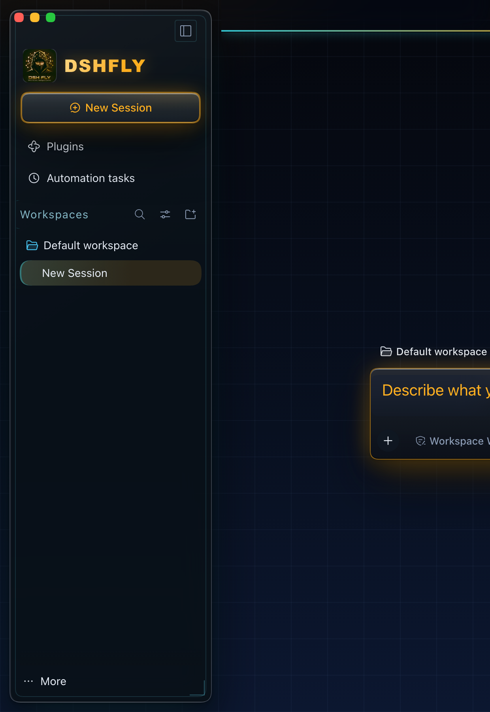
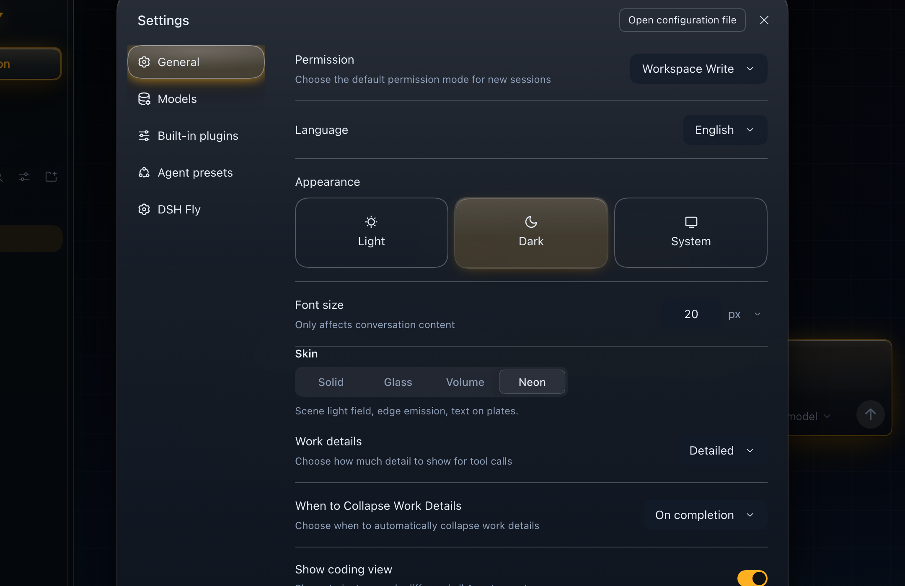
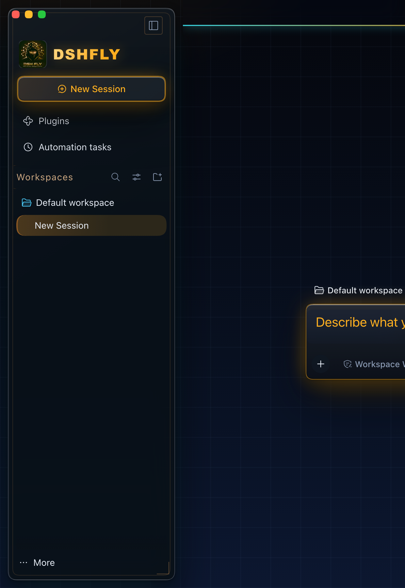

# 设计稿 · neon 科幻化（第一轮：HUD / EMBER）

> 产出日期 2026-10-18。范围：**只动 `neon` 主题的深色半区**；冻结的 solid/glass/volume 不动，浅色半区第二轮再谈。
> 这轮只到"方向 + 可执行稿"：**用户挑一个方向之后才改 `src/client/styles.ts`**。

## 1. 这是什么

把霓虹从"发光的浮卡"往"作战终端"推一层。霓虹现有的身份是**场景光场 + 边缘外溢发光**；
这一轮在它上面加**仪表面结构**：

- **场**：给画布加网格（微网格 + 主网格）与扫描线，让"背景"读起来像一块屏幕而不是一块渐变；
- **面**：卡片内缘一道内缩发丝框 + 右下角标，HUD 取景器语言；
- **行**：hover 走横向光扫，选中行左侧 2px 光条（带低频呼吸）；
- **字**：分组标题带左侧光条、字距 .06em、色温随方向走；
- **焦点**：双环冷/暖光，键盘可达性不掉。

两个方向只在**色温**上分岔，骨架完全一致（同一批选择器、同一份结构规则）：

| | A · HUD 战术终端 | B · 深空熔炉 |
| --- | --- | --- |
| 气质 | 冷光仪表、扫描线、青蓝 | 枪灰金属、琥珀地平线、暖光 |
| 场 | 24px 微网格 + 120px 主网格 + 3px 扫描线，右下青色地平线 | 32px 暖网格 + 160px 主网格，左下琥珀地平线 + 右上紫罗兰边光 |
| 光条 / 角标 | `rgba(104,226,248,…)` | `rgba(255,176,96,…)` |
| 按钮 | 内缘冷光发丝 + 青 glow | 淡琥珀充能渐变 + 琥珀 glow |

## 2. 对照图（全部是真页面注入 CSS 后截的，红绿灯是叠加色块）

| | 侧栏 | 设置弹窗 |
| --- | --- | --- |
| 现状 |  |  |
| A · HUD |  |  |
| B · EMBER |  |  |

复现渲染：`node .tmp/design-render.mjs`（在 `dsh-fly` 仓；脚本把本目录的两份 CSS 注入 scratch 实例的真页面后截图）。

## 3. 产物清单

| 文件 | 作用 |
| --- | --- |
| `variant-a-hud.css` | 方向 A 的**可执行稿**：截图就是它跑出来的；落地时整段搬进 `src/client/styles.ts` |
| `variant-b-ember.css` | 方向 B 同上 |
| `neon-scifi.tokens.ts` | 两个方向的 **token 层**（`--dsw-specific-fly-*` 形状，可直接并进 `tokens.ts` 的 `NEON_DARK`） |
| `README.md` | 本文：方向、规则、落地映射、已知坑、验收 |
| `shots/*.png` | 对照图 |

CSS 里用 `--fly-hud-*` 命名（渲染方便），入库时按 `neon-scifi.tokens.ts` 的 `NEON_SCIFI_ALIASES`
换成 `--dsw-specific-fly-hud-*`：**值必须逐字节一致**，由 `scripts/check-design-tokens.mjs` 钉住。

## 4. 设计规则明细

### 4.1 token（深色半区）

| CSS（设计稿） | 入库名 | A 值 | B 值 |
| --- | --- | --- | --- |
| `--fly-hud-line` | `--dsw-specific-fly-hud-line` | `rgba(104,226,248,.34)` | `rgba(255,176,96,.32)` |
| `--fly-hud-line-soft` | `--dsw-specific-fly-hud-line-soft` | `rgba(104,226,248,.14)` | `rgba(255,176,96,.13)` |
| `--fly-hud-glow` | `--dsw-specific-fly-hud-glow` | `rgba(53,211,224,.42)` | `rgba(255,150,48,.40)` |
| `--fly-hud-warm` | `--dsw-specific-fly-hud-warm` | `rgba(255,176,32,.55)` | `rgba(255,176,32,.55)` |
| `--fly-hud-ink` | `--dsw-specific-fly-hud-ink` | `rgba(168,232,248,.78)` | `rgba(255,208,158,.80)` |

另外沿用现有三颗：`--dsw-specific-fly-canvas`（换成本稿的网格场）、`-plate-bg`、`-plate-line`。

### 4.2 锚点（全部是已有钩子，不写死 hash）

| 表面 | 钩子 |
| --- | --- |
| 画布/场 | `body[data-ds-dark-theme]` 上的 `--dsw-specific-fly-canvas` |
| 侧栏卡 | `[class$='_frame']:has(> [class*='sidebarCol']) [class*='sidebarCol']` |
| 新会话按钮 | `button[class*='_newSession']`（**必须收窄到 button**，见 §6） |
| 折叠按钮 | `[class*='sidebarCol'] [class*='_toggle']` |
| 导航行 | `[class*='_panelRow']` |
| 工作区行 | `[class*='_groupSection']` / `[class*='_treeBody'] [class*='_row']` / `[class*='sessionRow'][class*='selected']` |
| 分组标题 | `[class*='_sectionHeader']` |
| 焦点 | `:is(button,a,[role='button'],input,textarea):focus-visible` |

### 4.3 动效

选中行光条的明暗呼吸：A 2.8s / B 3.2s，`ease-in-out` 无限循环；**只在 `prefers-reduced-motion: no-preference` 下生效**。

## 5. 落地映射（挑定方向后按这张表改）

1. `src/client/tokens.ts`：把选中方向的 5 颗 `--dsw-specific-fly-hud-*` 与三颗 canvas/plate 值并进 `NEON_DARK`
   （浅色半区先留空 = 第二轮；不要动 `NEON_LIGHT`）。
2. `src/client/styles.ts`：把选中方向 CSS 里**除 token 声明块以外**的规则整段搬进 neon 深色段
   （`NEON_DARK_SCOPE` 起头的那一段），`--fly-hud-*` 按 §3 的别名表换成 `--dsw-specific-fly-hud-*`。
3. `scripts/verify.mjs`（皮肤仓门禁）新增断言：
   - `--dsw-specific-fly-hud-line` 在 neon 下**解析出非空值**，且与 `tokens.ts` 的字面量一致；
   - 取景框**真的画出来**（hit-test 到卡片伪元素所在位置、或截图像素采样：内缩 6px 处出现 1px 亮线）；
   - 选中行左侧光条存在（`box-shadow` 含 `inset 2px`）；
   - `prefers-reduced-motion: reduce` 下 `animation-name` 为 `none`。
4. `docs/shots/` 补两张新画廊图（conversation / settings），README 的皮肤表同步。

## 6. 已知坑（都在这轮实测踩过）

1. **`[class*='_newSession']` 命中两个节点**：`button.newSession` 与里面的 `span.newSessionLabelMask`。
   第一版把内缘环写在 `[class*='_newSession']` 上，于是按钮内部多出一个方框 —— 必须写 `button[class*='_newSession']`。
2. **卡片与 frame 之间有一层无类名 div**：`[class$='_frame']:has(> [class*='sidebarCol']) > [class*='sidebarCol']`
   命中 **0 个**，取景框一条都画不出来。要写成后代选择器。
3. **标题字距**：`.14em` + `text-transform: uppercase` 会把 `Workspaces` 撑出容器被裁（截图里只剩 `WORKSPACE`）；
   现在 `.06em` 不加 uppercase，改为左侧光条承担"标签感"。
4. **按钮上别叠 `outline`**：New Session 已有一圈 glow 环，再 `outline-offset: 3px` 会在环内多出一个方框；
   内缘改用 `box-shadow: inset 0 0 0 1px`。
5. **角标位置**：右下角标在 460px 高的裁剪里看不见（卡片比裁剪高）；截图要拍全高，且**别把角标当唯一线索**。

## 7. 风险与验收

| 风险 | 处置 |
| --- | --- |
| 网格叠在光场上可能发"摩尔纹" | 微网格 4.5% / 主网格 8.5%，扫描线 1.2%；在 1× 屏（外接 2560×1440）上复核 |
| 发光元素过多导致糊 | 只保留三处发光：光标/选中条/按钮环；不做全局光晕 |
| 半透明板透出网格 → 文字对比度下降 | 板保持 ≥0.94 alpha（本稿 0.94/0.95），正文对比度用现有着色断言复核 |
| 动效干扰 | 仅 `no-preference` 下开；呼吸幅度 <30% 亮度 |

验收（落地后跑）：皮肤仓 `node scripts/verify.mjs` + 本仓 `pnpm build:clients` 后
`verify shell` 的皮肤段全绿；真机截图与本文对照图逐项对齐。

## 8. 下一步

1. 你从 A / B 里挑一个（或指定"混合"：例如 A 的冷场 + B 的暖按钮）；
2. 我按 §5 落地到 `src/client/{tokens,styles}.ts`，补 §5.3 的断言；
3. 出真机截图做逐像素对照（§3.5：同位置同尺寸 diff），确认没跑偏再发版。
